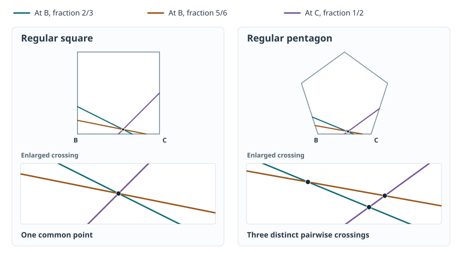

# Rational crossings in inscribed regular polygons

**Blake Stone · Proof developed with OpenAI Astra 6.2.**

Scott R. Shannon asked in 2022 which regular polygons can have a crossing of three or more segments when their sides are subdivided and the corresponding points are joined. We prove that exactly the triangle, square, and regular hexagon admit such a crossing. The classification gives the conjectured formulas for the numbers of regions, vertices, and edges in OEIS A357216, A357235, and A357254.

## The construction and result

Let a regular convex polygon have $n\ge3$ sides. Mark the fractions $t=j/(k+1)$, $1\le j\le k$, along each side, traversing the boundary in the same direction. Join consecutive sides' marks with the same $t$. Each $t$ gives a closed inscribed regular $n$-gon. We include the outer boundary in the drawing. A multiple crossing means an interior point lying on at least three distinct drawn segments.

**Theorem.** A multiple crossing occurs for some $k$ if and only if $n\in\{3,4,6\}$. For $n=5$ or $n\ge7$, the following formulas hold for every $k\ge0$.

| Quantity | Count | OEIS |
|---|---:|---|
| Regions inside the outer polygon | $nk^2+1$ | [A357216](https://oeis.org/A357216) |
| Vertices, including boundary vertices | $nk^2+n$ | [A357235](https://oeis.org/A357235) |
| Edges, including boundary edges | $2nk^2+n$ | [A357254](https://oeis.org/A357254) |

## Where three segments could meet

Write $A,B,C,D$ for successive vertices. Call the segment joining the mark on $AB$ to the mark on $BC$ a segment *at* $B$. In the affine coordinates with origin $B$ and basis $A-B,C-B$, its endpoints are $(1-t,0)$ and $(0,t)$. Its equation is therefore

$$
\frac{X}{1-t}+\frac{Y}{t}=1.
$$

Two such segments, at parameters $t\ne u$, cross at

$$
X=(1-t)(1-u),\qquad Y=tu.
$$

Substitution verifies both equations, and the point lies in the interior of both segments. Conversely a parameter $w$ whose line contains $(X,Y)$ satisfies $w^2+(X-Y-1)w+Y=0$. Thus no three segments at a single corner can meet. The intersection of a pair at one corner has **rational** $X,Y$, both positive.

Segments at two nonadjacent corners have their endpoints on separate boundary arcs, so their endpoints do not alternate around the polygon. They cannot cross in their interiors. Here we use the elementary chord criterion for a convex polygon: for four distinct boundary marks, the segments joining two pairs cross in the interior exactly when the pairs alternate along the boundary. The lines in question pass through the polygon interior, so no two distinct segments overlap along a line: each such line has a unique pair of boundary endpoints. For $n\ge5$, any three distinct corners include two nonadjacent ones. Consequently a multiple crossing would contain two segments at one corner and a third at a neighboring corner. We may take that neighbor to be $C$, reversing traversal and replacing all parameters by $1-t$ if necessary.

## The obstruction at the neighboring corner

Set $q=2\cos(2\pi/n)$. The successive unit side directions turn through $2\pi/n$, so

$$
D-C=(A-B)+q(C-B).
$$

Indeed the first and third directed side vectors $B-A$ and $D-C$ have sum $q(C-B)$. In coordinates at $C$ with basis $B-C,D-C$, the same point $(X,Y)$ has coordinates

$$
X'=1+qX-Y,\qquad Y'=X.
$$

If the segment at $C$ with rational parameter $v$ passes through this point, then

$$
\frac{1+qX-Y}{1-v}+\frac{X}{v}=1.
$$

Because $X,Y,v$ are rational and $X>0$, this forces $q$ to be rational. For a root of unity $\zeta=e^{2\pi i/n}$ we have $q=\zeta+\zeta^{-1}$. To see directly that a rational $q$ must be an integer, put $S_0(z)=2$, $S_1(z)=z$ and $S_{m+1}(z)=zS_m(z)-S_{m-1}(z)$. Induction gives $S_m(q)=\zeta^m+\zeta^{-m}$ and makes $S_m$ monic of degree $m$ for $m\ge1$. Thus $q$ is a rational root of the monic integer polynomial $S_n(z)-2$. It is an integer by the rational root theorem. For $n\ge3$, $2\cos(2\pi/n)$ increases strictly from $-1$ toward $2$, attaining the integers $-1,0,1$ at $n=3,4,6$, respectively. This excludes every other $n$.

## The three exceptions occur

In each row, take $t,u$ at $B$ and $v$ at $C$. The parameters are available for the indicated $k$. The listed coordinates satisfy the segment equations above. In the triangular case $D=A$, and the same coordinate change applies.

| $n$ | $k$ | $t$ | $u$ | $v$ | $(X,Y)$ at $B$ | $(X',Y')$ at $C$ |
|---:|---:|---:|---:|---:|---|---|
| 3 | 5 | $1/2$ | $5/6$ | $1/3$ | $(1/12,5/12)$ | $(1/2,1/12)$ |
| 4 | 5 | $2/3$ | $5/6$ | $1/2$ | $(1/18,5/9)$ | $(4/9,1/18)$ |
| 6 | 9 | $1/2$ | $9/10$ | $1/5$ | $(1/20,9/20)$ | $(3/5,1/20)$ |

## Counting the simple crossings

Assume $n=5$ or $n\ge7$. Each corner contributes $\binom{k}{2}$ intersecting pairs of its own segments. For the neighboring corners $B,C$, a segment at $B$ with parameter $t$ and a segment at $C$ with parameter $v$ cross in their interiors exactly when $v<t$: the endpoints on $BC$ must appear in that order for the two pairs of boundary endpoints to alternate. When $v=t$ the segments meet at their common boundary mark. Each of the $n$ neighboring corner pairs contributes $\binom{k}{2}$ interior crossings. There are no others. Since all crossings are simple, the number of distinct interior vertices is

$$
I=2n\binom{k}{2}=nk(k-1).
$$

There are $n(k+1)$ boundary vertices and just as many boundary edges. The $nk$ original interior chords contribute $nk+2I$ edges after splitting at their crossings. Therefore $V=n(k+1)+I=nk^2+n$ and $E=n(k+1)+nk+2I=2nk^2+n$. The graph is connected because all chords have endpoints on the outer boundary, so Euler's formula gives $E-V+1=nk^2+1$ bounded regions. This also covers $k=0$.

The same proof of simplicity applies if the equally spaced fractions are replaced by any finite set of distinct rational fractions in $(0,1)$ used consistently on every side. Reversing traversal replaces that set by its rational reflection; the argument still applies. The three counts then use its cardinality as $k$.

## Original sources

Scott R. Shannon, September 2022. [A357216, regions](https://oeis.org/A357216) · [A357235, vertices](https://oeis.org/A357235) · [A357254, edges](https://oeis.org/A357254).
